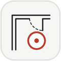
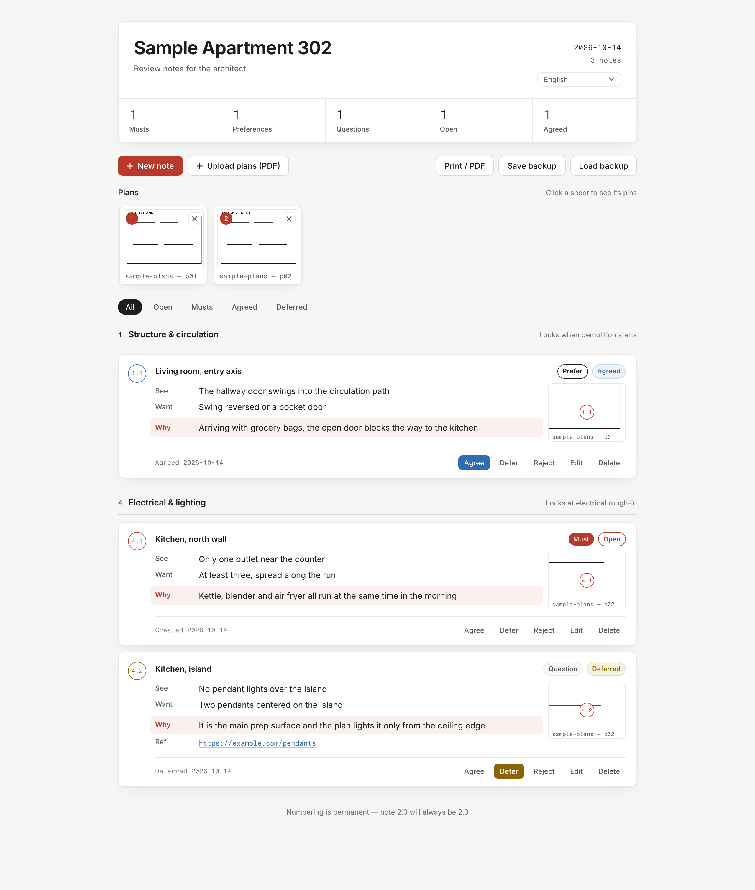
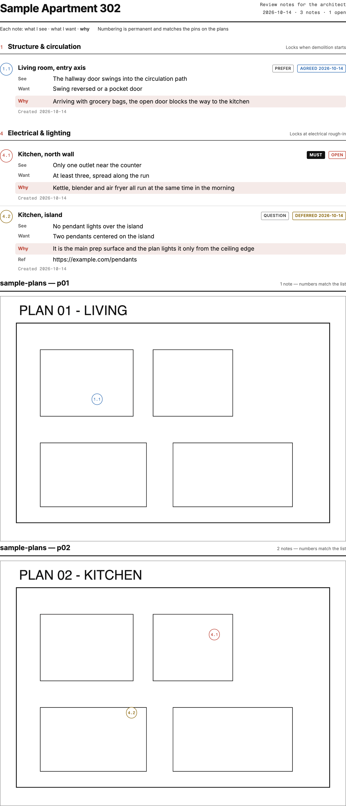
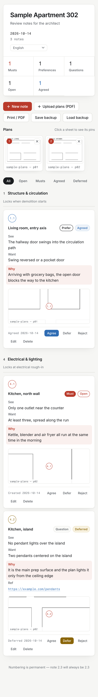

<div align="center">



# Redline

**Structured design review for your architect's drawings.**

</div>

Upload the PDF plans, pin numbered notes straight onto them, and hand back a
redlined package the architect can read natively — instead of losing
decisions across WhatsApp threads and email chains.

> *Redline*: a drawing marked up with review comments — the set that goes
> back and forth between client and architect before a design is signed off.

**[Try it in your browser →](https://rrickson.github.io/redline/)** — no
install, no account; your data never leaves the browser.

<p align="center">
  
</p>

<p align="center">
  
  &nbsp;
  
</p>

## Why

Reviewing an architecture or renovation project is a months-long negotiation,
and most of it happens in chat apps where decisions get relitigated, dropped,
or forgotten. Redline embeds a small, opinionated review method into a tool:

- **Every comment has five fields** — *Where · What I see · What I want ·
  **Why** · How firm* (Must / Prefer / Just a question). Giving the architect
  the underlying need instead of just your proposed solution usually gets a
  better answer back.
- **Six review layers, ordered by cost of change**, each with the moment it
  locks (structure locks at demolition, wet points at plumbing rough-in,
  electrical at rough-in, …) — so the conversation resolves top-down instead
  of jumping around.
- **Permanent numbering.** Note 2.3 is 2.3 forever, never reused, never
  renumbered. Every item carries a dated status — Open / Agreed / Rejected /
  Deferred — so nothing is silently dropped.
- **Notes live on the drawings.** Plans upload as PDF and split into sheets;
  each note pins to the exact spot, and the numbered callout follows it
  everywhere: the list, the thumbnail, and the printed package.

## Features

- 📌 PDF plan upload → per-page sheet library, with pan/zoom pin placement
- 🗂 Five-field notes filed under six cost-ordered layers, permanent numbering
- 🏷 Dated statuses (Open / Agreed / Deferred / Rejected) and quick filters
- 🖨 **Print / PDF**: a dedicated A4 document — the note list plus every plan
  sheet with its numbered callouts overlaid, the format architects read natively
- 💾 **Local-first**: everything stays in your browser (IndexedDB). No server,
  no account, no telemetry. One-click JSON backup embeds the plan images
- 📦 The production build is a single self-contained `dist/index.html`
  (React, pdf.js, and fonts embedded) that works offline from disk
- 🌐 **English, Português (Brasil), 简体中文, 日本語** — picked from your
  browser's language, switchable from the title block. The printed package
  follows the chosen language

## Getting started

Requires [Bun](https://bun.sh).

```bash
bun install
bun run dev        # dev server with hot reload
```

Or grab a portable copy:

```bash
bun run build      # emits dist/index.html — the whole app in one file
```

Open `dist/index.html` anywhere, even without internet.

## Usage

1. **Upload plans (PDF)** — upload the architect's PDF; each page becomes a
   sheet. Direct image upload works too.
2. **New note** — fill the five fields, pick the layer, and *mark the spot on
   the plan* to pin it on the drawing.
3. Track the conversation: mark notes **Agreed**, **Deferred**, or
   **Rejected** as the architect responds — every change is dated.
4. **Print / PDF** — save the redline package and send it.
5. **Save backup** regularly: your data lives only in this browser until
   you export it. The backup JSON restores everything, plan images included.

Missing your language? Adding one is a single file — see
[CONTRIBUTING.md](CONTRIBUTING.md#adding-a-language).

## Project layout

| Path | What it is |
|---|---|
| `src/App.jsx` | State, storage orchestration, toolbar, note list |
| `src/components/` | Editor, NoteCard, SheetShelf, PinPlacer |
| `src/print.js` | The dedicated print document generator |
| `src/storage.js` | IndexedDB persistence (localStorage fallback) |
| `src/sheets.js` | PDF → sheet images (pdf.js, inline worker) |
| `src/model.js` | Layers, firmness, statuses, doc shape |
| `src/i18n/` | Translator, language detection, and one file per locale |
| `src/fonts.js` | Self-hosted embedded fonts (Inter, Fragment Mono) |
| `DESIGN.md` | The design system — authoritative for any UI change |
| `scripts/capture.mjs` | Seeded screenshot capture for design review |
| `.github/workflows/pages.yml` | Builds and deploys the live demo to GitHub Pages |

## Development notes

- `bun scripts/capture.mjs` (with `bun run preview` running) seeds demo data
  in a headless Chrome profile and saves desktop/mobile/print screenshots to
  `.impeccable/review/`. Run `bun scripts/capture.mjs docs/screenshots` to
  refresh the images in this README.
- `?printdebug` on the app URL exposes `window.__printHtml()` to inspect the
  generated print document.

## Contributing

Issues and PRs are welcome, in Portuguese or English. Read
[CONTRIBUTING.md](CONTRIBUTING.md) first — Redline is deliberately small,
local-first, and opinionated about its review method, and contributions that
fit those constraints land fastest.

## License

[MIT](LICENSE) © Rickson Vasconcelos
